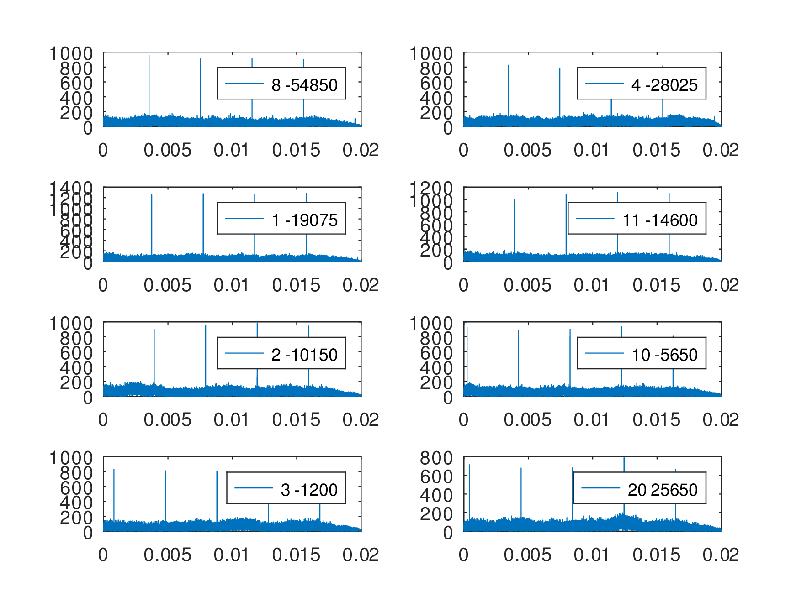
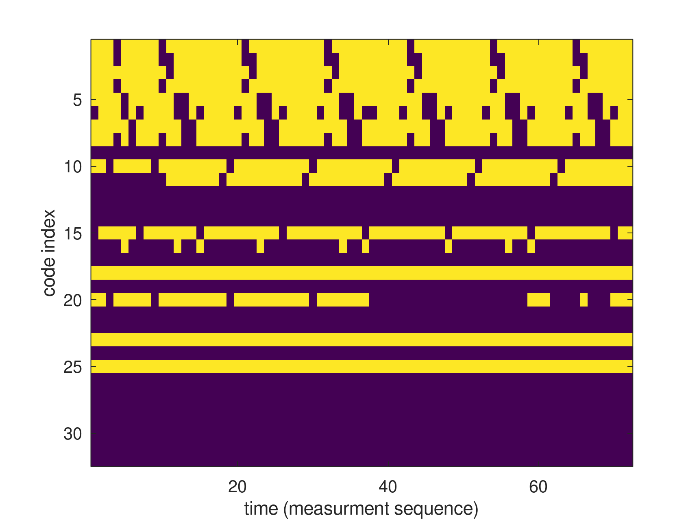
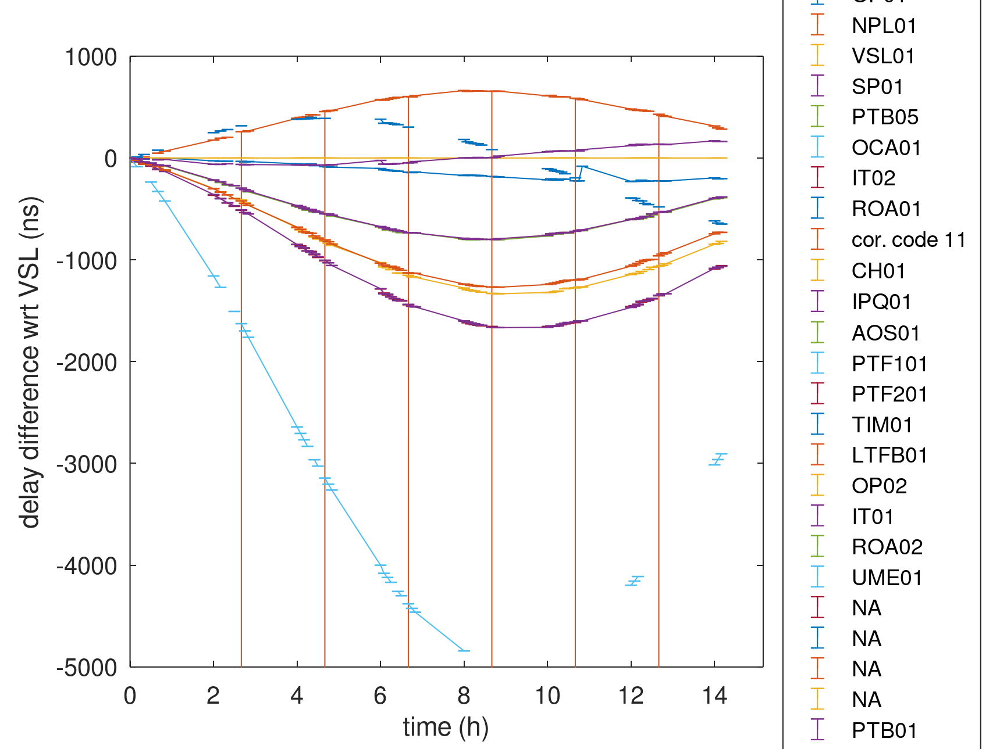

## Converting PRN sequence to a binary file compatible with GNU Radio


``taps.txt`` is converted to binary files with the Octave script
```
load ../taps.txt
for k=1:size(taps)(1) ; nom=['code',num2str(k,"%02d"),'.bin'],f=fopen(nom,'w');d=taps(k,:)*2-1;fwrite(f,d,'int8');fclose(f);end
```

Emitter locations (according to https://webtai.bipm.org/ftp/pub/tai/data/2025/time_transfer/twstft/):

Name  | latitude      | longitude      | alti |code|
------|---------------|----------------|------|--|
OP01  | 48.83589889   |  2.33496472    | 78.00|0 |
ROA01 | 36.46431389   | -6.20620361    | 74.67|7 |
SP01  | 57.71527778   | 12.89083333    |225.00|3 |
IT01  | 45.01499639   |  7.63907944    |306.64|17|
VSL01 | 51.98550556   |  4.38804167    | 76.80|2 |
CH01  | 46.92371833   |  7.46416722    |612.82|9 |
NPL02 | 51.42577778   | -0.34352778    | 68.00|? |
PTB05 | 52.29716306   | 10.46054611    |143.41|4 |

# Processing steps

Recording of a 5-second long sample using <a href="SATRE_TV_cli.grc">SATRE_TV_cli.grc</a> executed by
the <a href="crontab">crontab</a> and then processing the dataset searching for frequency offset
at the squared signal Fourier transform peaks (cancelling the BPSK spectrum spreading) and the associated
emitter:



The phase jumps marking the beginning of each second are removed when computing the delay difference
and its standard deviation.

# Result

The list of visible stations indexed by their code as a function of acquisition time (the crontab
schedule was adjusted to avoid recording when stations are idle):



and the resuling delay difference (wrt VSL01 as reference, and removing the time offset at the first recording)
as a function of recording time:


